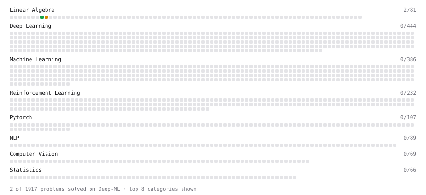

# Deep-ML

My machine learning practice from [Deep-ML](https://www.deep-ml.com). Every solution here was written by hand.

**7** solved · 4 problems · 0 labs · 3 math

[**Browse the interactive portfolio**](https://mindesohammm.github.io/deep-ml/) to replay this filling in over time.

## Problems

| | Difficulty | Solved | |
| --- | --- | --- | --- |
| [Calculate 2x2 Matrix Inverse](https://www.deep-ml.com/problems/8) | easy | 2026-11-06 | [solution](problems/0008-calculate-2x2-matrix-inverse) |
| [Implement Orthogonal Projection of a Vector onto a Line](https://www.deep-ml.com/problems/66) | easy | 2026-11-06 | [solution](problems/0066-implement-orthogonal-projection-of-a-vector-onto-a-line) |
| [Implement Gradient Descent Variants with MSE Loss](https://www.deep-ml.com/problems/47) | medium | 2026-11-08 | [solution](problems/0047-implement-gradient-descent-variants-with-mse-loss) |
| [Matrix times Matrix ](https://www.deep-ml.com/problems/9) | medium | 2026-11-06 | [solution](problems/0009-matrix-times-matrix) |

## Math

| | Difficulty | Solved | |
| --- | --- | --- | --- |
| [Derivatives and Gradients](https://www.deep-ml.com/math-problems/1) | easy | 2026-11-06 | [solution](math/0001-derivatives-and-gradients) |
| [Gradient Descent Updates](https://www.deep-ml.com/math-problems/5) | easy | 2026-11-06 | [solution](math/0005-gradient-descent-updates) |
| [Inverse and Rank](https://www.deep-ml.com/math-problems/12) | medium | 2026-11-06 | [solution](math/0012-inverse-and-rank) |

---

_This file is regenerated by Deep-ML on every push._
